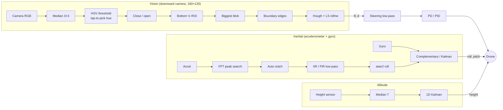

# Noise-Robust Path Tracking for an Autonomous Mini-Drone

Classical DSP (no AI/ML) for camera, IMU and altitude signals: DSP course project ("Digital Signal Processing in Today's Era", VJTI) and MathWorks Minidrone Competition India 2026 entry.

**Live demo:** open the GitHub Pages link on a phone and tap *Phone camera* or *Start phone sensors* to run the pipeline on the phone's real camera, accelerometer and gyroscope.

| Path | Chain |
|---|---|
| Vision | Median 3×3 → RGB→HSV threshold (tap-to-pick colour) → close/open (3×3 close for thin cables) → bottom-½ ROI → biggest blob → edges → Hough → least-squares refine → low-pass → PID |
| Inertial | FFT peak search → auto notch → low-pass → atan2 roll → complementary / Kalman fusion with gyro |
| Altitude | Median → moving average / 1D Kalman |

## Block diagram

## Screenshots

**Real-camera vision fix**: same frame (warm wooden floor, hand, red clutter, 2 px red cable; true angle 7.1°), before and after:

| Before: fixed red range, 5×5 opening, whole-frame Hough → −12° | After: tapped colour, thin-line close, ROI + biggest blob → 7.1° / 0.0 px |
|---|---|
|  |  |

**MATLAB simulation** (`matlab/minidrone_dsp_sim.m`):

| | |
|---|---|
|  |  |
|  |  |
|  |  |

**ESP32 + MPU6050 rig analysis** (`matlab/esp32_mpu6050_analysis.m`). These figures come from the script's built-in *simulated* log until a real rig CSV is recorded:

| | |
|---|---|
|  |  |
|  |  |

**Demo video**: _to add after recording: `docs/img/demo.gif` (about 10 s of the Camera tab on the real cable) and a link to the full video._

- `index.html`: the phone web app. Tabs:
  - **Camera / IMU / Altitude**: each path on its own, with filters you can switch off and sliders that inject noise
  - **Flight**: closed loop, comparing a raw drone and a DSP drone on the same noisy camera
  - **Drone**: camera and IMU together (track tracking plus an artificial horizon showing roll and pitch); hold the phone flat with the back camera facing down
  - **Navigate**: the phone locates itself with no extra hardware. Downward camera → Hann window → 2D FFT phase correlation (optical flow) → quality gate → median → low-pass, plus gyro heading with bias calibration and compass fusion. Shows a live map of a 150 × 100 cm arena with an obstacle, an A* route, arrow + voice directions, and raw vs filtered paths. Also has a simulation with ground truth and a 5-run drift test.
  - **Navigate with ESP32**: sources *Simulate ESP32* and *ESP32 via Bluetooth*. Anchors in the room corners give position through RSSI → median → Kalman → path-loss → trilateration → weighted least squares → position Kalman. The phone gives heading. A* route, arrow + voice. Room size and obstacles are set on the map. Firmware is in `hardware/esp32_beacon/`; filter switches + calibration are on the Beacon page (button in Navigate).
  - **📡 Phone → Laptop** (top right): stream the phone's camera and motion sensors to the same page on a laptop, so every tab runs on live phone data on the big screen. Laptop: *Laptop: show code*; phone: type the code, *Phone: send* (or open `…/?link=CODE`). WebRTC via PeerJS: the public PeerJS server only introduces the devices; both need internet.
  - **Navigate → Follow track (camera)**: directions come from the track the camera sees (Camera tab detection): Go straight / Slight left / Turn right, "Track lost", "Landing pad: stop". Hold the phone flat, camera down, ~30 cm above the track, top edge along it.
  - **Maze: shortest path from a photo** (Navigate): take a photo of a maze → the app finds the maze and its walls (even on a cluttered, tilted or slanted photo), finds the **shortest path** from the entrance to the exit (the gaps in the outer wall) with Dijkstra (corridor middles, fewest turns among equally short routes), **draws it as a red line** and then marks **Start** and **End**. Tap S and E to choose the ends yourself; tick *Trace a red line already drawn* to follow a drawn solution instead. **Path → CSV** saves `drone_route_maze.csv` for `matlab/route_to_waypoints.m`. Test images in `test_images/` (`maze_generated*.png/jpg`: true shortest path 34 turns; the app finds 34 on both the clean and the photo-like copy).
  - **Navigate → laptop**: with the link on, the phone stays the navigator (ESP32 over Bluetooth) and the laptop mirrors its map, route, position and directions live. **Route → CSV (for the drone)** saves the planned route's corner points; `matlab/route_to_waypoints.m` turns it into evenly spaced `[x y z]` waypoints + yaw in the drone frame (start on START facing up the map) and saves `drone_waypoints.mat`.
  - **Explore** (classical DSP + image processing only, no ML): one phone builds a map while you walk, detects static and moving obstacles and collisions, and guides you to a goal tapped on the map.
    - *Seeing*: floor colour model (learned at the start) → each image column scanned up to the first non-floor pixels → flat-floor pinhole geometry (camera height, pitch from gravity, FOV) turns that row into a distance → 5-column median → a "virtual laser scan" (trusted to 3.5 m).
    - *Mapping*: log-odds occupancy grid (10 cm) updated along Bresenham rays.
    - *Moving obstacles*: compact scan segments tracked with constant-velocity Kalman filters; "moving" only if it travels > 0.4 m over floor the map saw free, keeps a person-like constant width and moves > 0.3 m/s. Moving ones stay out of the static map and their next 2 s are blocked for the planner; cells already mapped as obstacles are never erased by this logic.
    - *Collisions*: time-to-collision from the low-passed forward range rate (and closing speed of moving tracks) → "Stop"; bump detector on high-passed |acceleration| → "Collision! Stop", an arc in front is blocked and the route is replanned.
    - *Position*: step detection (band-passed |a| peaks, 1-5 m/s²) × step length along the heading (gyro rate about gravity, bias measured in the first second, compass fused).
    - *Traversal*: A* (binary heap) on the grid with a body-radius margin, replanned every 0.4 s; arrow + voice as in Navigate.
    - *Simulate room* renders the camera image of an 8 × 6 m room with 4 boxes and 2 walking people and simulated motion sensors, so the whole pipeline runs end to end. 12 simulated runs: 12/12 reached the goal, 10/12 without collision (one person walking into the walker, one single box bump recovered), every collision detected, median map precision 86-97 %, median position drift 0.3-0.5 m.
    - *Endpoint from the camera*: tap the floor in the camera view (same flat-floor geometry → a point on the map; tapped points land within 1 cm in the simulation), or put a **blue sheet** on the floor and tap 🎯: the app turns you a full circle, explores toward open floor if it is not in sight, and locks onto it (blue blob, must be flat: top-to-bottom floor depth < 1.2 m, not cut off by the image edge). No path or map is needed beforehand. Simulation: tapped endpoints reached; blue marker found and reached in 4/4 runs, also when it starts out of sight.
    - *Live*: hold the phone upright at chest height in portrait, back camera forward, tilted ~20° down; stand still on clear floor, Start, tap a goal, walk.
  - **Results**: runs every comparison from the proposal with a fixed seed (E1 filter vs filter, E2 accuracy vs noise, E3 FIR vs IIR, notch and fusion, E4 altitude, E5 flight), then Copy tables or Download CSV
  - Falls back to simulated sensors when the real ones are unavailable.
- `PLAN_A.md`: **the demo plan**. Three proofs matching proposal §4: Simulink minidrone, ESP32 + MPU6050 vibration rig, real track + landing pad.
- `hardware/esp32_mpu6050/`: 500 Hz MPU6050 streaming firmware (IMU tab → ESP32 + MPU6050 (USB)).
- `matlab/esp32_mpu6050_analysis.m`: FFT / notch / FIR vs IIR / fusion analysis of rig logs, plus frequency response, pole-zero and spectrogram plots. Uses the newest `mpu6050_log*.csv` in the folder; without one it runs on a labelled simulated log.
- `matlab/simulink/`: MATLAB Function blocks (toolbox-free, fixed-size, code-generation friendly), `test_simulink_blocks.m` to check them in plain MATLAB, and a guide for the parrotMinidroneCompetition model.
- `matlab/minidrone_dsp_sim.m`: the full simulation in MATLAB. Runs on plain MATLAB: the toolbox functions are written out as local functions.
- `test_images/real_floor.png`: a realistic test frame for the Camera tab's *Photo* source.
- `matlab/phone_sensor_demo.m`: the same pipeline on real phone data via MATLAB Mobile (`mobiledev`).

Team: Rayon Biswas, Zaid Faruqui, Tanisha Nevrekar, Piyush Patil, Ananya Rane, Hood Shaikh, Arpit Rajput.
